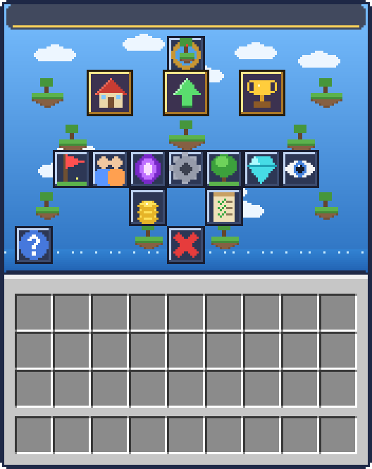

# ☁ 섬 메뉴 UI — ItemsAdder + DeluxeMenus (Java 1.20.4)



상자 GUI 전체를 하늘·떠있는 섬 테마 배경으로 덮고, 버튼 14개를 전용 아이콘으로 바꾼 섬(스카이블럭) 메뉴입니다.
(위 그림의 4번 칸은 실제로는 플레이어 머리 + 섬 정보가 표시됩니다.)

## 필요 플러그인
- **ItemsAdder** 3.6+ · **DeluxeMenus** · **PlaceholderAPI**
- 섬 플러그인: **SuperiorSkyblock2** 기준 (BentoBox 는 아래 대응표대로 명령만 바꾸면 됨)
- PAPI 확장: `/papi ecloud download Player` → `/papi reload`

## 설치
1. `plugins/` 를 서버 `plugins/` 에 덮어쓰기
2. `plugins/DeluxeMenus/config.yml` 의 `gui_menus:` 아래에 추가
   ```yaml
   gui_menus:
     island_menu:
       file: island_menu.yml
   ```
3. 콘솔: `iazip` → `dm reload`
4. 열기: `/섬`, `/island_menu`, 또는 `/iagive <플레이어> yaybae_island:island_compass` 로 받은 **섬 나침반** 우클릭

## 버튼
| 칸 | 버튼 | SuperiorSkyblock2 | BentoBox(AOneBlock/BSkyBlock) |
|---|---|---|---|
| 4 | 섬 정보 (머리) | 플레이스홀더 표시 | `%Level_bskyblock_island_level%` 등으로 교체 |
| 11 | 섬으로 이동 | `is go` | `is go` |
| 13 | 섬 업그레이드 | `is upgrades` | `is upgrade` (Upgrades 애드온) |
| 15 | 섬 순위 | `is top` | `is top` (Level 애드온) |
| 28 | 홈 설정 | `is sethome` | `is sethome` |
| 29 | 섬원 관리 | `is members` | `is team` |
| 30 | 워프 | `is warps` | `is warps` (Warps 애드온) |
| 31 | 섬 설정 | `is settings` | `is settings` |
| 32 | 바이옴 | `is biome` | `is biomes` (Biomes 애드온) |
| 33 | 섬 가치 | `is value` | `is level` |
| 34 | 방문자 | `is visitors` | `is expel` 등 |
| 39 | 섬 은행 | `is bank` | `is bank` (Bank 애드온) |
| 41 | 미션 | `is missions` | `is challenges` |
| 45 | 도움말 | `is help` | `is help` |
| 49 | 닫기 | — | — |

명령은 `plugins/DeluxeMenus/gui_menus/island_menu.yml` 의 `'[player] is ...'` 줄만 바꾸면 됩니다.

## 구조
```
plugins/
├─ ItemsAdder/contents/yaybae_island/
│  ├─ configs/island_ui.yml                 배경 font_image + 아이콘 아이템 15개
│  └─ resourcepack/assets/yaybae_island/textures/
│     ├─ gui/island_menu.png                176×222 GUI 배경
│     └─ icon/*.png                         16×16 아이콘
└─ DeluxeMenus/gui_menus/island_menu.yml    메뉴 (54칸)
```

## 원리 / 조정
- 메뉴 제목 `&f%img_offset_-8%%img_island_menu%%img_offset_-168%&f&l☁ 나의 섬`
  - `offset_-8` 로 배경을 GUI 왼쪽 끝에 맞추고, 배경을 그린 뒤 `offset_-168` 로 되돌아와 제목 글자를 씁니다.
  - 앞의 `&f` 가 없으면 배경이 회색으로 물듭니다.
- 배경이 위아래로 어긋나면 `island_ui.yml` 의 `y_position` (기본 13) 을 1씩 조정하세요.
- 배경을 고치려면 `python3 tools/gen_island_ui.py` 의 `background()` 를 수정하거나 PNG 를 직접 편집하세요.
  버튼 위치를 바꾸면 `BUTTON_SLOTS` 와 메뉴 yml 의 `slot` 을 같이 바꿔야 테두리가 맞습니다.
- `%img_...%` 가 글자 그대로 보이면 PlaceholderAPI 미설치이거나 ItemsAdder 버전에 따라
  `%img_yaybae_island_island_menu%` 형식이 필요할 수 있습니다.
