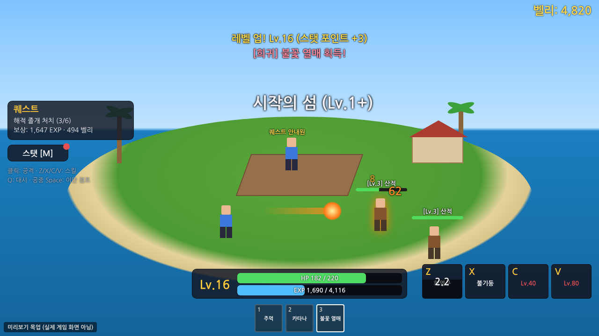
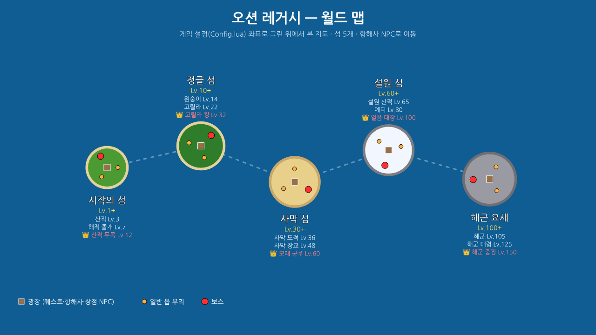

# 🌊 오션 레거시 (Ocean Legacy) — 로블록스 게임

킹레거시 같은 **해적 RPG** 로블록스 게임입니다. 섬을 돌며 몹을 잡고, 레벨을 올리고, 스탯을 찍고, 악마의 열매와 검으로 보스를 쓰러뜨리세요.




> 위 이미지는 UI 배치와 맵 구성을 보여주는 **미리보기 목업**입니다. 실제 화면은 Studio에서 실행해 확인하세요.

## 바로 플레이하기 (Roblox Studio)

1. `dist/OceanLegacy.rbxlx` 파일을 다운로드합니다.
2. **Roblox Studio**에서 `파일 → 열기`로 이 파일을 엽니다.
3. 상단의 **▶ 플레이(F5)** 를 누르면 맵(바다·섬 5개)과 몹, NPC가 자동 생성됩니다.
4. 저장 기능을 테스트하려면 게임을 한 번 게시(Publish)한 뒤
   `홈 → 게임 설정 → 보안 → Studio의 API 서비스 접근 허용`을 켜세요. (끄면 저장 없이도 정상 동작)

## 조작법

| 키 | 동작 |
|---|---|
| 1, 2, 3… | 무기 선택 (주먹 / 검 / 열매) |
| 마우스 클릭 (꾹 누르기) | 기본 공격 (4타 콤보, 마지막 타 넉백) |
| **Z / X / C / V** | 무기별 스킬 (마우스 방향으로 시전) |
| **Q** | 대시 |
| 공중에서 **Space** | 이단 점프 |
| **M** | 스탯 창 |
| **E** | NPC와 대화 |

모바일은 화면 오른쪽 아래 스킬 버튼과 대시 버튼으로 플레이할 수 있습니다.

## 게임 내용

**섬 5개** — 항해사 NPC로 이동 (레벨 제한)

| 섬 | 레벨 | 몹 | 보스 |
|---|---|---|---|
| 시작의 섬 | 1+ | 산적, 해적 졸개 | 산적 두목 (Lv.12) |
| 정글 섬 | 10+ | 원숭이, 고릴라 | 고릴라 킹 (Lv.32) |
| 사막 섬 | 30+ | 사막 도적, 사막 장교 | 모래 군주 (Lv.60) |
| 설원 섬 | 60+ | 설원 산적, 예티 | 얼음 대장 (Lv.100) |
| 해군 요새 | 100+ | 해군, 해군 대령 | 해군 중장 (Lv.150) |

- **퀘스트**: 섬 광장의 퀘스트 안내원에게 말을 걸면 내 레벨에 맞는 퀘스트를 줍니다. (그 섬이 부활 지점이 됨)
- **레벨/스탯**: 최대 Lv.300, 레벨당 3포인트 → 근접 / 방어(체력) / 검술 / 열매
- **악마의 열매** (시작의 섬 열매 상인, 2,500 벨리 랜덤 뽑기)
  - 일반: 고무 · 희귀: 불꽃, 얼음 · 전설: 빛, 진동 · 신화: 어둠
  - 열매마다 Z/X/C/V 스킬 4개 (Lv.1 / 15 / 40 / 80 해금) — 화상, 빙결(기절), 끌어당기기, 넉백 등
- **검** (대장장이): 카타나 → 커틀러스 → 사브르 → 용의 검 → 흑도. 스킬: 일섬(돌진), 회전 베기, 참격파(관통)
- **보스**: 체력바·넉백 저항·주변 범위 공격, 처치 시 서버 전체 알림
- **저장**: 레벨, 경험치, 벨리, 스탯, 검, 열매, 퀘스트 (DataStore, 2분마다 자동 저장)

## 수정하기

밸런스는 전부 `src/ReplicatedStorage/Shared/Config.lua` 한 파일에 있습니다.
몹 추가, 열매 스킬 추가, 가격·경험치 조정 등은 이 파일만 고치면 됩니다.

```
src/
├─ ReplicatedStorage/Shared/Config.lua        설정 (섬, 몹, 퀘스트, 검, 열매, 스킬)
├─ ServerScriptService/
│  ├─ Main.server.lua                          서버 시작
│  └─ Server/
│     ├─ MapBuilder.lua      바다/섬/장식/NPC 생성
│     ├─ EnemyService.lua    몹 생성·AI·피격·리스폰
│     ├─ CombatService.lua   기본 공격·스킬 처리
│     ├─ PlayerService.lua   데이터 저장·레벨업·스탯·무기 지급
│     ├─ QuestShopService.lua 퀘스트·열매 뽑기·검 상점·섬 이동
│     ├─ Rig.lua             NPC 캐릭터 모델
│     └─ Effects.lua         스킬 이펙트, 데미지 숫자
└─ StarterPlayer/StarterPlayerScripts/Client.client.lua   UI·입력
```

수정 후 `python3 tools/build_rbxlx.py`를 실행하면 `dist/OceanLegacy.rbxlx`가 다시 만들어집니다.
[Rojo](https://rojo.space)를 쓴다면 `rojo serve`로 Studio와 실시간 동기화할 수도 있습니다 (`default.project.json` 포함).
